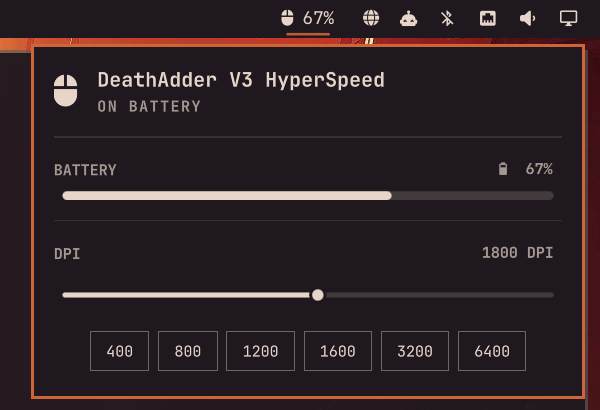

# Razer Mouse for Omarchy

An [Omarchy](https://omarchy.org) bar widget that shows your Razer mouse's battery level at a glance and lets you change its DPI, in a popup styled after Omarchy's built-in Audio panel.



## Features

- **Battery in the bar** — mouse icon with the battery percentage (and a bolt while charging). The icon switches to your theme's warning color when the battery runs low.
- **Battery panel** — device name, status (on battery / charging / battery low) and a level meter.
- **DPI selector** — a slider covering the mouse's full range (logarithmic, so everyday values get most of the travel) plus one-click presets: 400, 800, 1200, 1600, 3200, 6400.
- **Any Razer mouse** — every mouse the OpenRazer daemon knows about is supported; if several are connected, the panel shows a device picker.
- **Keyboard driven** — like the Audio panel: `j`/`k` move between rows, `h`/`l` nudge DPI by 100 or walk the presets, `Enter` applies, `r` refreshes, `Esc` closes. Right-click the bar icon to refresh.

Tested with the Razer DeathAdder V3 HyperSpeed (wireless).

## Requirements

This plugin reads and controls the mouse through [OpenRazer](https://openrazer.github.io/):

```bash
sudo pacman -S --needed openrazer-daemon openrazer-driver-dkms python-dbus
systemctl --user enable --now openrazer-daemon
```

If the daemon can't see your mouse, add yourself to the `plugdev` group and log out and back in:

```bash
sudo gpasswd -a "$USER" plugdev
```

If the daemon isn't running, the panel offers a one-click button to start it.

## Install

```bash
omarchy plugin add https://github.com/ozdogar-ai/razer-mouse-for-omarchy --enable
```

The widget appears in the right section of the bar. Move it with `omarchy bar move ozdogar.razer-mouse --section <left|center|right>`.

## Settings

Edit the plugin's entry in `~/.config/omarchy/shell.json`:

| Key                  | Default | Meaning                                              |
|----------------------|---------|------------------------------------------------------|
| `showPercentage`     | `true`  | Show the battery percentage next to the bar icon     |
| `lowBatteryPercent`  | `20`    | Warn (warning color) at or below this level          |
| `refreshIntervalSec` | `60`    | How often to poll while the panel is closed (5s when open) |

## Remove

```bash
omarchy plugin remove ozdogar.razer-mouse
```

This removes only the plugin. OpenRazer stays installed; to remove it too:

```bash
systemctl --user disable --now openrazer-daemon
sudo pacman -Rns openrazer-daemon openrazer-driver-dkms
```

## How it works

`Panel.qml` is the bar widget and popup, built from Omarchy's shared UI components. It calls `razer-mice.py`, a small Python script that talks to the OpenRazer daemon over the session D-Bus and prints JSON (`status`) or sets the DPI (`set-dpi SERIAL DPI`). Nothing runs as root and no files outside the plugin are written.

## License

[MIT](LICENSE)
